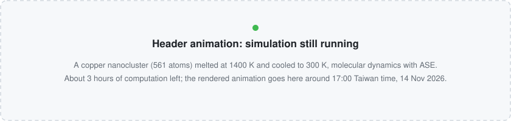

  <picture>
    <source media="(prefers-color-scheme: dark)" srcset="assets/header-placeholder-dark.svg">
    
  </picture>

### Hi, I'm Shuru 👋

<picture>
  <source media="(prefers-color-scheme: dark)" srcset="assets/stats-dark.svg">
  
</picture>

Chemical engineering and materials student in Taiwan.

I build small tools for computational materials science and check the numbers they produce. What I care about most: knowing when a model should not be trusted.

- Play with the interactive pages: [crystal ML under distribution shift](https://shuruyue.github.io/Materials-ML-Primer/web/data_splits.html), [ethanol–water VLE](https://shuruyue.github.io/Ethanol-Water-VLE/web/ethanol-water-vle.html), [XRD crystallite size](https://shuruyue.github.io/XRD-Analysis/web/crystallite-size.html), [urea–nitrate cell](https://shuruyue.github.io/Urea-Nitrate-Cell/web/cell-explorer.html), [quantum-dot photodetector](https://shuruyue.github.io/Quantum-Dot-Photodetector/web/quantum-dot-explorer.html), [numerical methods](https://shuruyue.github.io/Computational-Materials-Science/web/numerical-methods.html)
- Talk with me by [email](mailto:zhongyue364@gmail.com)

 

  <picture>
    <source media="(prefers-color-scheme: dark)" srcset="assets/quotes-dark.svg">
    
  </picture>

The header is a real simulation, not a drawing: a copper nanocluster melted at 1400 K and cooled to 300 K (ASE effective-medium-theory potential, Langevin thermostat), cut in half and colored by adaptive common neighbor analysis in OVITO. Script, settings and data: [animation/](animation/).
